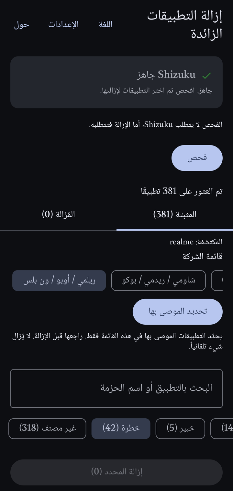
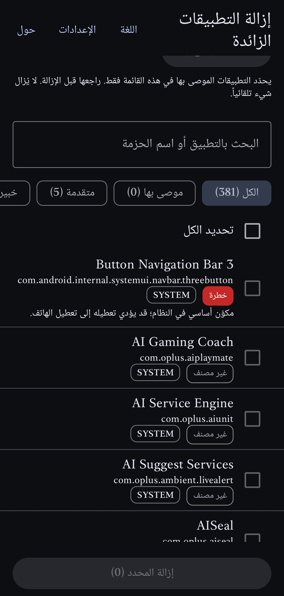
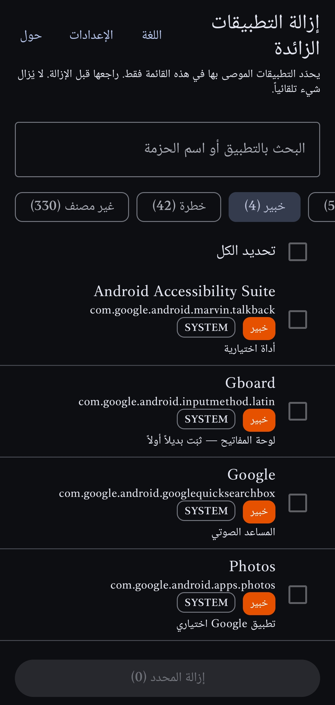
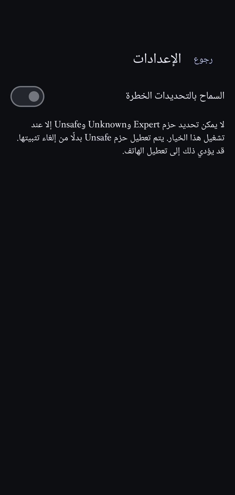
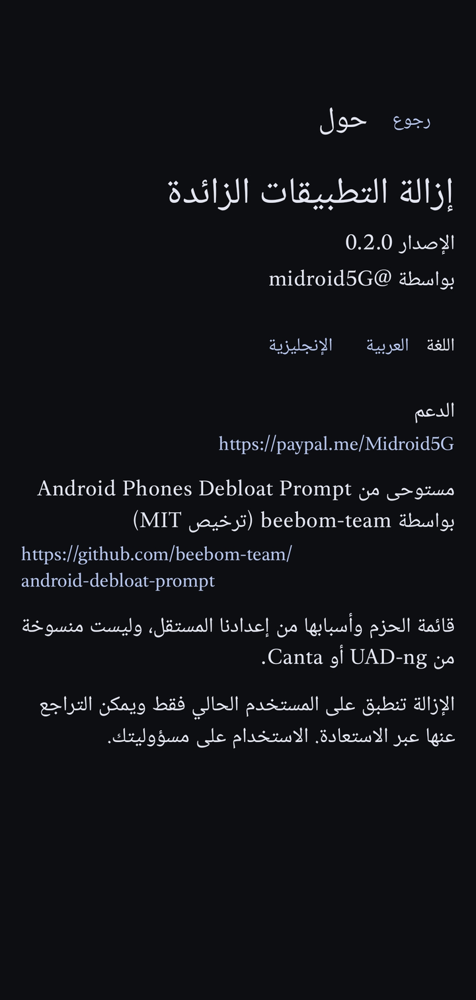

<p align="center">
  
  <br>
  <strong>Mi5G Debloat</strong><br>
  إزالة التطبيقات الزائدة
</p>

<p align="center">
  <a href="https://github.com/al3nkboot/mi5g-debloat/releases/latest"></a>
  <a href="https://github.com/al3nkboot/mi5g-debloat/releases"></a>
  <a href="LICENSE"></a>
  
  
  <a href="https://shizuku.rikka.app/"></a>
</p>

<p align="center">
  <a href="#العربية">العربية</a> · <a href="#english">English</a> ·
  <a href="https://github.com/al3nkboot/mi5g-debloat/releases/latest"><strong>تنزيل / Download</strong></a>
</p>

# العربية

يزيل أو يعطّل تطبيقات النظام المثبّتة مسبقاً للمستخدم الحالي، بدون روت، عبر [Shizuku](https://shizuku.rikka.app/). يوزَّع من GitHub وليس من Google Play.

## المميزات

- قوائم جاهزة حسب الشركة، مع اكتشاف تلقائي وإمكانية التبديل إلى شركة أخرى أو «الكل»
- زر **تحديد الموصى بها** يضع علامات للمراجعة فقط — لا يُزال شيء تلقائياً
- خمسة تصنيفات: موصى بها، متقدمة، خبير، خطرة، غير مصنف
- الحزم الخطرة تُعطَّل ولا تُزال، وخلف خيار في الإعدادات (مغلق افتراضياً)
- قائمة المثبتة تعرض تطبيقات النظام فقط؛ تطبيقات المستخدم مخفية
- الاستعادة من تبويب المُزالة
- العربية (RTL) لغة افتراضية، مع التحويل إلى الإنجليزية من التطبيق

## لقطات

من الإصدار **0.2.0** على جهاز Realme 15 5G حقيقي.

<p>





</p>

## التنزيل

[تنزيل أحدث إصدار (APK)](https://github.com/al3nkboot/mi5g-debloat/releases/latest)

يتطلب أندرويد 8.0 (API 26) أو أحدث، وShizuku قيد التشغيل مع منح الإذن للتطبيق.

## إعداد Shizuku

1. ثبّت [Shizuku](https://shizuku.rikka.app/download/) من موقعه أو من Google Play.
2. شغّله بدون روت عبر **التصحيح اللاسلكي** (أو حسب تعليمات Shizuku).
3. افتح Mi5G Debloat وامنحه إذن Shizuku عندما يُطلب.

الفحص يعمل بدون Shizuku. الإزالة والاستعادة تحتاجانه.

## التصنيفات والتحذير

| التصنيف | السلوك |
|---|---|
| موصى بها | مرشّحات الإزالة، كل منها بمصدرين مستقلين على الأقل |
| متقدمة | ميزات اختيارية من الشركة؛ قابلة للتحديد مع تأكيد إضافي |
| خبير / غير مصنف / خطرة | لا تُحدَّد إلا بعد تفعيل «السماح بالتحديدات الخطرة» في الإعدادات |

الحزم **الخطرة** تُعطَّل ولا تُزال. بقية التصنيفات تحاول الإزالة لمستخدمك الحالي ثم تسقط إلى التعطيل إن فشلت.

⚠️ **إزالة تطبيقات النظام على مسؤوليتك.** قد تتعطّل ميزات أو يحدث إقلاع حلقي (bootloop)، وقد تحتاج إلى إعادة ضبط المصنع. ابدأ بالموصى بها، واحتفظ بطريقة للاستعادة.

## قوائم الشركات (0.2.0)

عدد الحزم في الملفات المرفقة. قائمة جوجل/AOSP والشركاء تُدمج مع الشركة المختارة. الحزم الخطرة من كل القوائم تُطبَّق دائماً.

| القائمة | النظام | موصى بها | متقدمة | خبير | خطرة |
|---|---|---:|---:|---:|---:|
| سامسونج | One UI | 13 | 14 | 9 | 12 |
| شاومي / ريدمي / بوكو | HyperOS / MIUI | 6 | 24 | 6 | 12 |
| ريلمي / أوبو / ون بلس | ColorOS / realme UI / OxygenOS | 14 | 20 | 5 | 21 |
| هونر / هواوي | MagicOS / EMUI | 2 | 32 | 6 | 15 |
| فيفو / iQOO | Funtouch / OriginOS | 11 | 16 | 2 | 10 |
| جوجل / AOSP والشركاء | — | 8 | 17 | 4 | 0 |

الاختبار على جهاز حقيقي في هذا المشروع كان على ريلمي 15 5G في إصدارات 0.1.x. قوائم الشركات الأخرى مبنية على المصادر ولم تُؤكَّد على تلك الأجهزة.

## أسئلة شائعة

**كيف أستعيد تطبيقاً؟** من تبويب المُزالة: استعادة أو استعادة الكل. المعطّل يُفعَّل بـ `pm enable`، والمُزال يعود بـ `install-existing` إن بقيت النسخة في صورة النظام.

**لماذا لا تظهر تطبيقاتي؟** قائمة المثبتة تعرض تطبيقات النظام فقط. إزالة تطبيق ثبّته أنت بـ `pm uninstall --user 0` تحذفه دون نسخة نظام يمكن استرجاعها من هنا.

**ماذا لو توقف الهاتف عن الإقلاع؟** هذا خطر حقيقي إذا أزلت حزماً خطرة أو أساسية. لا تُزل ما لا تفهمه. إن استطعت الوصول عبر ADB: `adb shell cmd package install-existing --user 0 <pkg>`. وإلا فقد تحتاج إلى وضع الاسترداد أو إعادة ضبط المصنع (تمسح بياناتك).

## البناء من المصدر

تحتاج إلى JDK 17 وAndroid SDK.

```sh
git clone https://github.com/al3nkboot/mi5g-debloat.git
cd mi5g-debloat
./gradlew :app:assembleDebug
```

توقيع إصدار الإطلاق يُقرأ من الملف الذي يشير إليه `MI5G_DEBLOAT_SIGNING_PROPERTIES` أو من `~/.gradle/mi5g-debloat-signing.properties`. لا تضع المفتاح أو كلمة المرور في المستودع.

## الحقوق والدعم

مستوحى من [Android Phones Debloat Prompt](https://github.com/beebom-team/android-debloat-prompt) لـ beebom-team (رخصة MIT). قوائمنا وأسبابنا مستقلة، **وليست منسوخة من UAD-ng أو Canta**.

[@midroid5G](https://github.com/midroid5G) · الدعم: [PayPal](https://paypal.me/Midroid5G)

رخصة MIT — انظر [LICENSE](LICENSE). حقوق © 2026 @midroid5G.

---

# English

Removes or disables preinstalled **system** apps for the current Android user, without root, via [Shizuku](https://shizuku.rikka.app/). Distributed on GitHub, not Google Play.

## Features

- Ready-made lists per brand, with auto-detection and a switch to another brand or **All**
- **Select recommended** only ticks Recommended apps for review — nothing is removed automatically
- Five tiers: Recommended, Advanced, Expert, Unsafe, Unknown
- Unsafe packages are disabled, never uninstalled, and stay behind a Settings toggle (off by default)
- The Installed tab lists system apps only; user-installed apps are hidden
- Restore from the Uninstalled tab
- Arabic (RTL) is the default, with an in-app switch to English

## Screenshots

From **0.2.0** on a real Realme 15 5G.

<p>


</p>

## Download

[Download the latest APK](https://github.com/al3nkboot/mi5g-debloat/releases/latest)

Requires Android 8.0 (API 26) or newer, and Shizuku running with permission granted to this app.

## Shizuku setup

1. Install [Shizuku](https://shizuku.rikka.app/download/) from its site or Google Play.
2. Start it without root using **wireless debugging** (or follow Shizuku’s own instructions).
3. Open Mi5G Debloat and grant the Shizuku permission when asked.

Scanning works without Shizuku. Removal and restore need it.

## Tiers and risk

| Tier | Behaviour |
|---|---|
| Recommended | Removal candidates, each checked against at least two independent sources |
| Advanced | Optional vendor features; selectable by default, with an extra confirmation |
| Expert / Unknown / Unsafe | Selectable only after **Allow unsafe selections** is turned on in Settings |

**Unsafe** packages are disabled, never uninstalled. Other tiers try a per-user uninstall first, then fall back to disable.

⚠️ **Removing system apps is at your own risk.** It can break features, cause a bootloop, or require a factory reset. Start with Recommended and keep a way to restore.

## Brand lists (0.2.0)

Counts are for the bundled JSON files. The Google/AOSP and partner list is merged with the selected brand. Unsafe entries from every list always apply.

| List | Skin | Recommended | Advanced | Expert | Unsafe |
|---|---|---:|---:|---:|---:|
| Samsung | One UI | 13 | 14 | 9 | 12 |
| Xiaomi / Redmi / POCO | HyperOS / MIUI | 6 | 24 | 6 | 12 |
| Realme / OPPO / OnePlus | ColorOS / realme UI / OxygenOS | 14 | 20 | 5 | 21 |
| Honor / Huawei | MagicOS / EMUI | 2 | 32 | 6 | 15 |
| vivo / iQOO | Funtouch / OriginOS | 11 | 16 | 2 | 10 |
| Google / AOSP + partners | — | 8 | 17 | 4 | 0 |

Hardware testing in this project was on a Realme 15 5G during earlier 0.1.x builds. Other brand lists are source-based and have not been confirmed on those phones.

## FAQ

**How do I restore an app?** Use **Restore** or **Restore all** on the Uninstalled tab. Disabled packages are turned back on with `pm enable`. Uninstalled packages come back with `install-existing` if a copy remains on the system image.

**Why are my apps missing?** Installed shows system/preinstalled packages only. Uninstalling a user-installed app with `pm uninstall --user 0` deletes it with no system-image copy to restore here.

**What if the phone will not boot?** That is a real risk if you remove unsafe or core packages. Do not remove what you do not understand. If you can reach the device over ADB: `adb shell cmd package install-existing --user 0 <pkg>`. Otherwise you may need recovery or a factory reset (which wipes your data).

## Build from source

You need JDK 17 and the Android SDK.

```sh
git clone https://github.com/al3nkboot/mi5g-debloat.git
cd mi5g-debloat
./gradlew :app:assembleDebug
```

Release signing is loaded from the file in `MI5G_DEBLOAT_SIGNING_PROPERTIES` or from `~/.gradle/mi5g-debloat-signing.properties`. Never commit the keystore or passwords.

## Credits and support

Inspired by [Android Phones Debloat Prompt](https://github.com/beebom-team/android-debloat-prompt) by beebom-team (MIT License). Our package lists and reasons are curated independently and are **not copied from UAD-ng or Canta**.

[@midroid5G](https://github.com/midroid5G) · Support: [PayPal](https://paypal.me/Midroid5G)

MIT — see [LICENSE](LICENSE). Copyright (c) 2026 @midroid5G.
